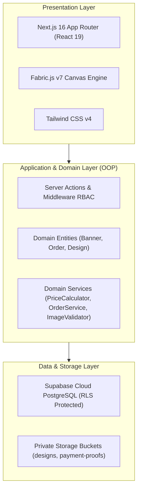

# 🖨️ BannerIN — Sistem Informasi Pemesanan Banner Online

[](https://nextjs.org/)
[](https://react.dev/)
[](https://www.typescriptlang.org/)
[](https://tailwindcss.com/)
[](https://supabase.com/)
[](https://github.com/aryarakapermana/BannerIN)

> **BannerIN** adalah platform web modern untuk layanan pemesanan spanduk dan digital printing yang mengotomatisasi seluruh alur bisnis percetakan: mulai dari pemilihan bahan, kalkulasi ukuran & harga otomatis, studio kanvas preview desain interaktif, transaksi pembayaran QRIS statis, hingga pelacakan status pesanan real-time bagi konsumen dan panel operasional back-office bagi administrator.

---

## 📑 Daftar Isi
- [Latar Belakang & Masalah](#-latar-belakang--masalah)
- [Fitur Utama](#-fitur-utama)
- [Arsitektur & Konsep Akademis](#-arsitektur--konsep-akademis)
- [Dokumentasi Lengkap (Mata Kuliah)](#-dokumentasi-lengkap-mata-kuliah)
- [Teknologi yang Digunakan](#-teknologi-yang-digunakan)
- [Struktur Direktori Proyek](#-struktur-direktori-proyek)
- [Panduan Instalasi & Menjalankan Lokal](#-panduan-instalasi--menjalankan-lokal)
- [Pengujian Otomatis (Testing)](#-pengujian-otomatis-testing)
- [Lisensi & Pengembang](#-lisensi--pengembang)

---

## 🎯 Latar Belakang & Masalah
Pada industri percetakan digital printing konvensional, proses pemesanan sering mengalami kendala:
1. **Miskomunikasi Harga:** Tanya-jawab berulang di WhatsApp mengenai estimasi harga berdasarkan panjang $\times$ lebar kustom.
2. **Kekhawatiran Desain Terpotong:** Konsumen kesulitan membayangkan proporsi spanduk asli serta posisi lubang mata ayam (*grommet*) dan lipatan tepi (*safe margin*).
3. **Ketidakpastian Status Produksi:** Tidak adanya sistem pelacakan mandiri untuk mengetahui apakah pesanan sudah masuk antrean cetak atau siap diambil.

**Solusi BannerIN:** Mengintegrasikan kalkulator luas otomatis, kanvas editor Fabric.js berbasis rasio fisik asli, checkout terproteksi server (*anti-manipulasi inspect element*), dan pelacakan stepper 4 tahap real-time.

---

## ✨ Fitur Utama

### 👤 Pengalaman Konsumen (Customer Experience)
- **Katalog Bahan & Harga Transparan:** Menampilkan daftar bahan outdoor/indoor (Flexi Standard 280g, Flexi Premium 340g, Flexi Korea 440g, Albatros) dengan tarif per $\text{m}^2$ resmi dari database.
- **Kalkulator Luas & Biaya Instan:** Formula baku:
  $$\text{Luas (m}^2) = \frac{\text{Lebar (cm)}}{100} \times \frac{\text{Tinggi (cm)}}{100}$$
  $$\text{Total Biaya} = \text{Luas} \times \text{Tarif Bahan/m}^2 \times \text{Jumlah}$$
- **Studio Editor Kanvas (Fabric.js v7):** Kanvas interaktif yang merender rasio spanduk secara akurat, mendukung unggah gambar (JPG/PNG maks 20 MB), geser/skala gambar, serta fitur toggle *garis potong & mata ayam*.
- **Checkout Pembayaran QRIS Statis:** Menampilkan QRIS toko resmi, formulir kontak WhatsApp pemesan, dan upload bukti transfer (maks 10 MB).
- **Portal & Invoice Konsumen:** Pelacakan pesanan via nomor invoice unik `#BK-...`, status stepper 4 tahap, dan cetak invoice snapshot transaksi.

### 🛡️ Panel Administrator (Back-Office Management)
- **Metrik Real-time:** Ringkasan pesanan hari ini, pesanan perlu konfirmasi, sedang diproduksi, dan omset total.
- **Verifikasi Bukti Transfer:** Modal peninjauan bukti transfer pelanggan untuk persetujuan atau penolakan pesanan.
- **Unduh Berkas Desain Asli:** Tombol download berkas desain resolusi asli melalui *Signed URL* privat berbatas waktu 1 jam untuk diproses ke mesin percetakan.
- **Full CRUD Pesanan & Bahan:** Kemampuan membuat pesanan manual, mengedit dimensi/bahan dengan kalkulasi ulang harga server, dan memperbarui tarif per $\text{m}^2$.

---

## 🏛️ Arsitektur & Konsep Akademis

Proyek ini dirancang secara komprehensif untuk memenuhi standar akademis pada 3 mata kuliah:



---

## 📚 Dokumentasi Lengkap (Mata Kuliah)

Dokumentasi rinci per mata kuliah dapat diakses langsung pada berkas berikut:

| Dokumen | Topik & Mata Kuliah | Ringkasan Isi |
| :--- | :--- | :--- |
| 📘 [**DOKUMENTASI_APSI.md**](./docs/DOKUMENTASI_APSI.md) | **Analisis & Perancangan Sistem Informasi** | Use Case Diagram, Activity Diagram, Class Diagram, Aktor, & System Layering |
| 📙 [**DOKUMENTASI_PBO.md**](./docs/DOKUMENTASI_PBO.md) | **Pemrograman Berbasis Objek (OOP)** | Penerapan 4 Pilar PBO (Abstraksi, Enkapsulasi, Polimorfisme, SRP) & Bedah Kode Domain |
| 📗 [**DOKUMENTASI_BASIS_DATA.md**](./docs/DOKUMENTASI_BASIS_DATA.md) | **Sistem Basis Data (PostgreSQL)** | ERD Mermaid, Kamus Data 4 Tabel, RLS Security, Bucket Storage, & Normalisasi 1NF-3NF |
| 🎤 [**PANDUAN_PRESENTASI_BANNERIN.md**](./docs/PANDUAN_PRESENTASI_BANNERIN.md) | **Pitch Deck & Presentasi Publik** | Naskah presentasi 5-7 menit, demonstrasi live alur pemesanan, & antisipasi tanya-jawab |

---

## 🛠️ Teknologi yang Digunakan

- **Frontend:** [Next.js 16](https://nextjs.org/) (App Router), [React 19](https://react.dev/), [Tailwind CSS v4](https://tailwindcss.com/)
- **Canvas Editor:** [Fabric.js v7](https://fabricjs.com/) (Client-side dynamic canvas manipulation)
- **Backend / Database:** [Supabase Cloud](https://supabase.com/) (PostgreSQL 15+, Supabase Auth, Storage)
- **Bahasa Pemrograman:** [TypeScript 5](https://www.typescriptlang.org/)
- **Testing:** Node.js native test runner & [tsx](https://github.com/privatenumber/tsx) (62 Automated Unit & Integration Tests)
- **CI/CD:** GitHub Actions (`.github/workflows/supabase-migration.yml`)

---

## 📁 Struktur Direktori Proyek

```text
bannerku/
├── docs/                             # Berkas dokumentasi akademis lengkap (APSI, PBO, SBD)
│   ├── DOKUMENTASI_APSI.md
│   ├── DOKUMENTASI_PBO.md
│   ├── DOKUMENTASI_BASIS_DATA.md
│   └── PANDUAN_PRESENTASI_BANNERIN.md
├── public/                           # Aset statis & foto produk resmi BannerIN
│   ├── images/landing/               # Foto mesin cetak, roll banner, x-banner, etalase
│   ├── qris-bannerku.jpg             # QRIS statis resmi
│   └── logo.png
├── src/
│   ├── app/                          # Next.js App Router (Halaman & Server Actions)
│   │   ├── (auth)/                   # Login & Register
│   │   ├── (public)/                 # Landing Page & Katalog Bahan
│   │   ├── studio/                   # Studio Kanvas Fabric.js
│   │   ├── checkout/                 # Checkout Pesanan & Upload Bukti Bayar
│   │   ├── dashboard/                # Admin Back-Office Management
│   │   └── customer/dashboard/       # Portal & Pelacakan Pesanan Konsumen
│   ├── components/                   # Komponen Reusable UI
│   ├── domain/                       # Core Business Logic OOP (Murni TypeScript)
│   │   ├── Banner.ts                 # Class Banner & Validasi Dimensi
│   │   ├── Order.ts                  # Class Order & Anti-IDOR Logic
│   │   ├── Design.ts                 # Class Design & Konfigurasi Kanvas
│   │   ├── IPriceCalculator.ts       # Interface Kalkulasi Harga
│   │   ├── PriceCalculator.ts        # Service Perhitungan Luas & Total
│   │   ├── OrderService.ts           # Service Pembuatan Pesanan Server-Authoritative
│   │   └── ImageFileValidator.ts     # Verifikasi Magic Bytes Biner File
│   └── lib/                          # Client Supabase & Utilitas
├── supabase/
│   ├── migrations/                   # Skema SQL, RLS Policies, & Storage Buckets
│   └── config.toml                   # Konfigurasi Supabase CLI
└── test/                             # 62 Test Suites Pengujian Menyeluruh
    ├── Fase8Calculator.test.ts
    ├── Fase9Design.test.ts
    ├── OrderCheckout.test.ts
    └── Fase13Matrix.test.ts
```

---

## 🚀 Panduan Instalasi & Menjalankan Lokal

### 1. Prasyarat Sistem
- Node.js versi `18.18.0` atau yang lebih baru
- Akun Supabase (untuk database dan storage)

### 2. Kloning Repositori
```bash
git clone https://github.com/aryarakapermana/BannerIN.git
cd BannerIN
```

### 3. Instal Dependensi
```bash
npm install
```

### 4. Konfigurasi Environment Variables
Salin berkas `.env.local.example` menjadi `.env.local` lalu lengkapi kredensial Supabase Anda:
```env
NEXT_PUBLIC_SUPABASE_URL=https://your-project-ref.supabase.co
NEXT_PUBLIC_SUPABASE_ANON_KEY=your-anon-key
SUPABASE_SERVICE_ROLE_KEY=your-service-role-key
```

### 5. Jalankan Development Server
```bash
npm run dev
```
Buka peramban Anda di [http://localhost:3000](http://localhost:3000).

---

## 🧪 Pengujian Otomatis (Testing)

Seluruh logika bisnis diuji secara berkala dengan 62 skenario pengujian:

```bash
npm test
```

Hasil verifikasi:
```text
ℹ tests 62
ℹ suites 27
ℹ pass 62
ℹ fail 0
ℹ duration_ms ~400ms
```

---

## 👨‍💻 Pengembang
- **Nama:** Arya Raka Permana
- **Proyek:** BannerIN — Sistem Informasi Layanan Pemesanan Banner Online
- **Repositori:** [https://github.com/aryarakapermana/BannerIN](https://github.com/aryarakapermana/BannerIN)
