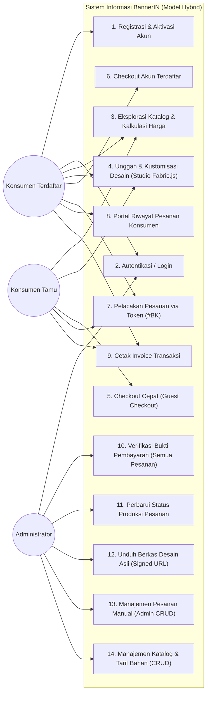
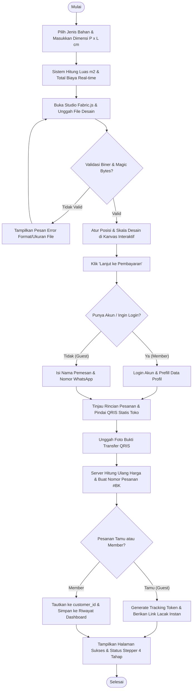
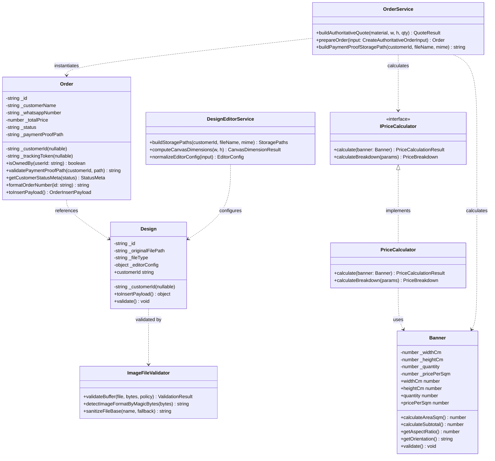

# Dokumen Analisis & Perancangan Sistem Informasi (APSI)
## Proyek: Sistem Informasi Pemesanan Banner Online (BannerIN)
### Arsitektur Sistem: Hybrid Guest Checkout, Fabric.js Canvas Studio, & Server-Authoritative

---

### 1. Gambaran Umum & Deskripsi Sistem
**BannerIN** adalah sistem informasi berbasis web yang dirancang untuk mengotomatisasi seluruh alur bisnis percetakan banner digital printing, mulai dari katalog bahan, kalkulasi luas dan harga interaktif, kustomisasi kanvas desain secara real-time, transaksi pembayaran QRIS statis, hingga pelacakan status produksi dan manajemen pesanan back-office oleh administrator.

#### 1.1 Masalah pada Sistem Konvensional
1. **Komunikasi Berulang:** Konsumen dan staf percetakan sering terjebak dalam chat manual mengenai estimasi harga berdasarkan ukuran custom ($P \times L$) dan jenis bahan.
2. **Kesesuaian Rasio & Margin Cetak:** Konsumen sering mengirimkan desain tanpa memahami rasio banner sesungguhnya, risiko terpotong pada garis lipat (*margin finishing*), atau posisi mata ayam (*grommet*).
3. **Friksi Pendaftaran Akun (Cart Abandonment):** Pada percetakan kilat, mewajibkan pelanggan mendaftar dan verifikasi email sebelum memesan menyebabkan *drop-off* calon pelanggan hingga 40%.
4. **Pencatatan Manual:** Antrean pesanan rentan hilang atau tertukar tanpa sistem invoice unik dan pencatatan status produksi terpusat.

#### 1.2 Solusi BannerIN
- **Automated Price Calculator:** Menghitung luas $\text{m}^2 = \frac{\text{lebar}}{100} \times \frac{\text{tinggi}}{100}$ dan total harga secara presisi berbasis tarif bahan real-time dari database.
- **Interactive Fabric.js Canvas Studio:** Memproyeksikan kanvas kerja sesuai rasio nyata ($P:L$), dilengkapi garis potong aman (*safe zone*) dan preview mata ayam.
- **Model Hybrid Guest Checkout:** Pengunjung dapat langsung mendesain dan memesan tanpa login (*guest checkout*) dengan pelacakan instan via *secure tracking token*, sementara pelanggan terdaftar tetap dapat login untuk mengelola riwayat pesanan terpusat di dashboard.
- **Role-Based Access Control (RBAC):** Pemisahan hak akses antara Konsumen (katalog, studio, checkout, invoice, pelacakan) dan Admin (full CRUD pesanan, konfirmasi pembayaran, download berkas resolusi asli, manajemen bahan).

---

### 2. Aktor Sistem
1. **Pengunjung / Konsumen Tamu (Guest Customer):**
   Pengguna publik tanpa akun yang dapat mengeksplorasi katalog bahan, menghitung tarif, mendesain spanduk di Studio Fabric.js, melakukan checkout cepat dengan menginput nama & WhatsApp, mengunggah bukti bayar QRIS, dan menerima tautan pelacakan instan (*tracking token*) untuk memantau status pengerjaan pesanan tanpa harus login.
2. **Konsumen Terdaftar (Registered Customer):**
   Pengguna yang memiliki akun terverifikasi. Seluruh pesanan otomatis terhubung ke `customer_id` mereka dan tersimpan permanen di *Customer Dashboard* (`/customer/dashboard`) untuk pemesanan berulang, cetak ulang invoice, dan riwayat transaksi multi-pesanan.
3. **Administrator:**
   Pengelola percetakan yang memiliki hak akses penuh ke Admin Portal (`/dashboard`). Bertugas memverifikasi bukti pembayaran (baik dari tamu maupun konsumen terdaftar), memperbarui status pengerjaan pesanan (*pending* $\to$ *confirmed* $\to$ *processing* $\to$ *completed*), mengunduh file desain asli resolusi tinggi untuk dicetak ke mesin, serta mengelola katalog bahan dan tarif per $\text{m}^2$.

---

### 3. Use Case Diagram



#### Deskripsi Spesifikasi Use Case Utama:
* **UC-04 (Kustomisasi Desain):** Pengguna (tamu maupun terdaftar) mengunggah file JPG/PNG (maks 20 MB). Sistem memvalidasi *magic bytes* biner file, menyimpannya di Supabase Storage privat (folder `guest/` untuk tamu atau `{user_id}/` untuk akun terdaftar), lalu merender kanvas Fabric.js sesuai rasio dimensi banner.
* **UC-05 & UC-06 (Checkout Hybrid):**
  - **Tamu:** Mengisi nama dan WhatsApp, mentransfer ke QRIS toko, mengunggah bukti bayar, dan sistem menerbitkan pesanan dengan `customer_id: null` serta `tracking_token` ber-entropi tinggi.
  - **Terdaftar:** Data nama dan WhatsApp terisi otomatis dari profil, pesanan otomatis dikaitkan ke `customer_id` pengguna untuk tampil di riwayat akun.
* **UC-07 (Pelacakan via Token / Akun):** Pelacakan pesanan dapat diakses melalui `/customer/orders/[id]?token=[tracking_token]` bagi tamu tanpa login, atau secara langsung via dashboard bagi pengguna login.
* **UC-10 s/d UC-12 (Operasional Produksi):** Admin meninjau preview bukti bayar tamu dan terdaftar, mengunduh file desain resolusi asli melalui *Signed URL* privat berbatas waktu 1 jam, lalu memajukan status pesanan hingga *completed*.

---

### 4. Activity Diagram

#### 4.1 Activity Diagram: Alur Pemesanan Banner (Hybrid Guest & Member)


#### 4.2 Activity Diagram: Alur Pemrosesan Pesanan oleh Administrator
```mermaid
flowchart TD
    StartAdmin([Mulai]) --> B1[Login Administrator]
    B1 --> B2[Akses Admin Dashboard /dashboard]
    B2 --> B3[Filter Pesanan 'Perlu Konfirmasi' (Tamu & Member)]
    B3 --> B4[Buka Modal Detail Pesanan & Tinjau Bukti Bayar]
    B4 --> B5{Bukti Transfer Valid?}
    B5 -- Tidak Sah / Ditolak --> B6[Ubah Status Menjadi 'cancelled']
    B5 -- Sah --> B7[Ubah Status Menjadi 'confirmed']
    B7 --> B8[Unduh File Desain Resolusi Asli via Signed URL]
    B8 --> B9[Kirim Berkas ke Mesin Cetak & Ubah Status ke 'processing']
    B9 --> B10[Banner Selesai Dicetak, Ubah Status ke 'completed']
    B6 --> EndAdmin([Selesai])
    B10 --> EndAdmin
```

---

### 5. Class Diagram (Arsitektur Perangkat Lunak)

Sistem menerapkan pemisahan tugas (*Separation of Concerns*) antara *Domain Entity*, *Domain Service*, dan *Presentation Layer*:



---

### 6. Arsitektur Sistem (Layered Architecture)
1. **Presentation Layer (Frontend):** Next.js 16 App Router, React 19, Tailwind CSS v4, Fabric.js v7 canvas rendering engine.
2. **Application / Action Layer (Server Actions & Route Handlers):** Menjalankan validasi input, autentikasi sesi via `@supabase/ssr`, pemanggilan *Domain Service*, dan proteksi rute di Next.js Middleware. Mendukung aliran otentikasi hybrid (Guest Token + Session Cookie).
3. **Domain Layer (Business Logic OOP):** Model entitas murni TypeScript (`Banner`, `Order`, `Design`, `PriceCalculator`, `DesignEditorService`, `OrderService`) tanpa dependensi langsung ke framework atau database.
4. **Data Persistence & Security Layer:** Supabase Cloud PostgreSQL, Row Level Security (RLS) Hybrid (`customer_id IS NULL OR customer_id = auth.uid()`), dan Supabase Storage buckets privat dengan proteksi enkripsi dan Signed URL.
5. **Quality Assurance:** Didukung **70 pengujian otomatis unit & integrasi (100% PASS)** yang memvalidasi seluruh skenario fungsional sistem.
