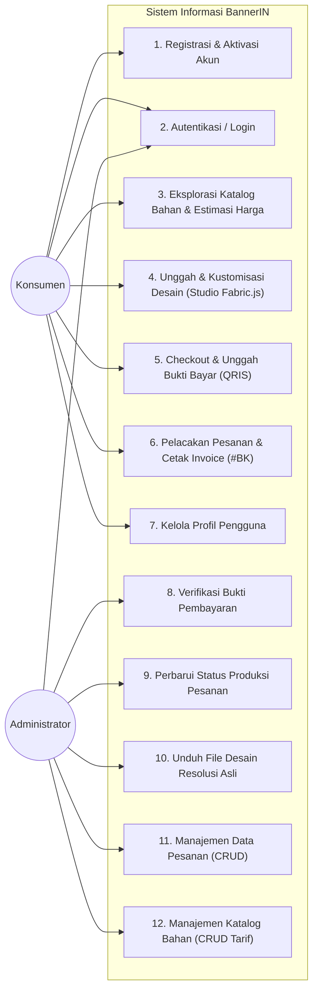
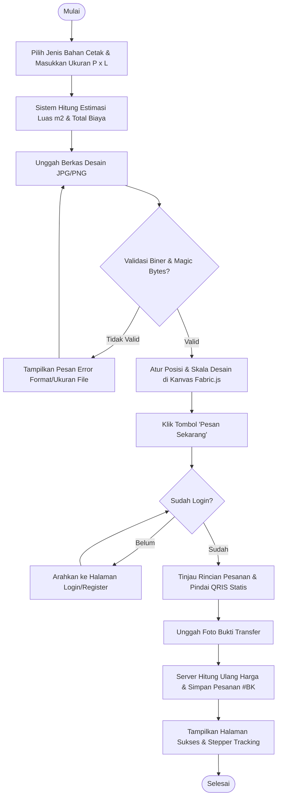
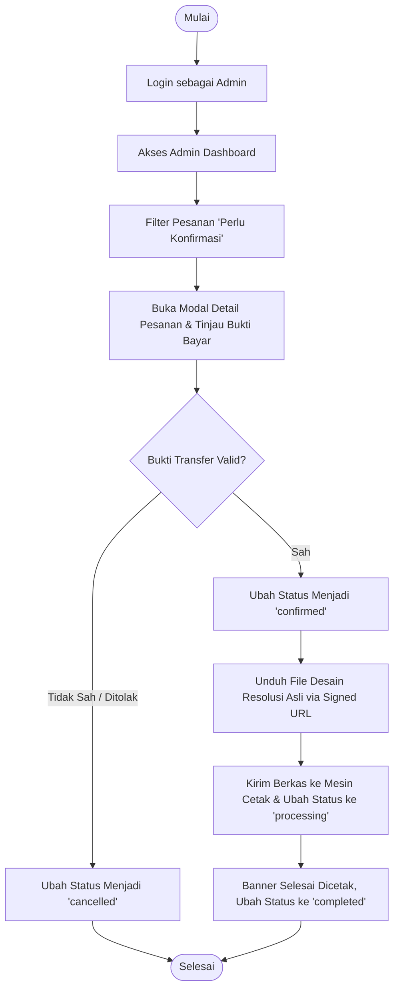
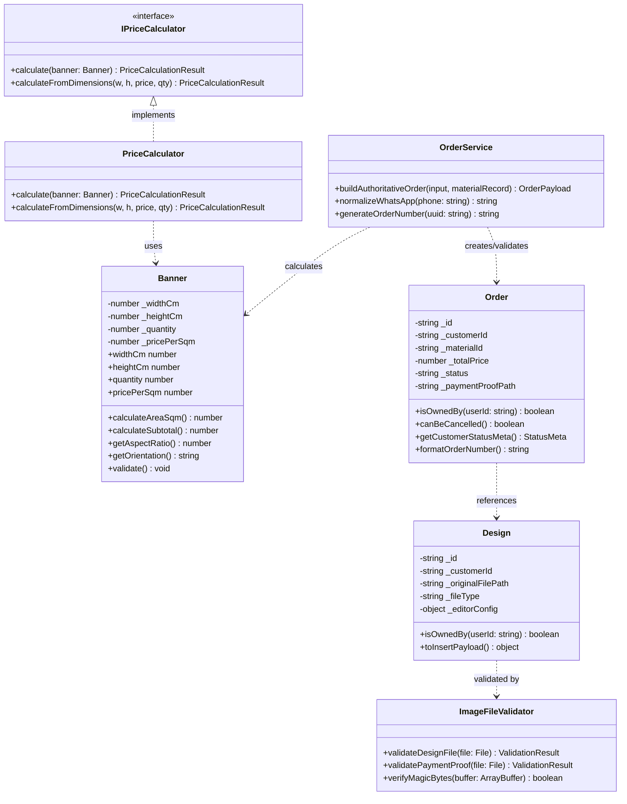

# Dokumen Analisis & Perancangan Sistem Informasi (APSI)
## Proyek: Sistem Informasi Pemesanan Banner Online (BannerIN)

---

### 1. Gambaran Umum & Deskripsi Sistem
**BannerIN** adalah sistem informasi berbasis web yang dirancang untuk mengotomatisasi seluruh alur bisnis percetakan banner digital printing, mulai dari katalog bahan, kalkulasi luas dan harga interaktif, kustomisasi kanvas desain secara real-time, transaksi pembayaran QRIS statis, hingga pelacakan status produksi dan manajemen pesanan back-office oleh administrator.

#### 1.1 Masalah pada Sistem Konvensional
1. **Komunikasi Berulang:** Konsumen dan staf percetakan sering terjebak dalam chat manual mengenai estimasi harga berdasarkan ukuran custom ($P \times L$) dan jenis bahan.
2. **Kesesuaian Rasio & Margin Cetak:** Konsumen sering mengirimkan desain tanpa memahami rasio banner sesungguhnya, risiko terpotong pada garis lipat (*margin finishing*), atau posisi mata ayam (*grommet*).
3. **Pencatatan Manual:** Antrean pesanan rentan hilang atau tertukar tanpa sistem invoice unik dan pencatatan status produksi terpusat.

#### 1.2 Solusi BannerIN
- **Automated Price Calculator:** Menghitung luas $\text{m}^2 = \frac{\text{lebar}}{100} \times \frac{\text{tinggi}}{100}$ dan total harga secara presisi berbasis tarif bahan real-time dari database.
- **Interactive Fabric.js Canvas Studio:** Memproyeksikan kanvas kerja sesuai rasio nyata ($P:L$), dilengkapi garis potong aman (*safe zone*) dan preview mata ayam.
- **Role-Based Access Control (RBAC):** Pemisahan hak akses antara Konsumen (katalog, studio, checkout, invoice, pelacakan) dan Admin (full CRUD pesanan, konfirmasi pembayaran, download berkas resolusi asli, manajemen bahan).

---

### 2. Aktor Sistem
1. **Konsumen (Customer):** Pengguna terdaftar yang memesan banner, mengunggah dan mengatur posisi desain pada editor studio, melakukan checkout dengan bukti bayar QRIS, serta melacak status produksi pesanan.
2. **Administrator:** Pengelola percetakan yang memverifikasi bukti pembayaran, memperbarui status pengerjaan pesanan (*pending* $\to$ *confirmed* $\to$ *processing* $\to$ *completed*), mengunduh file desain asli resolusi tinggi untuk dicetak ke mesin, serta mengelola katalog bahan dan tarif per $\text{m}^2$.

---

### 3. Use Case Diagram

#### Deskripsi Spesifikasi Use Case Utama:
* **UC-04 (Kustomisasi Desain):** Konsumen mengunggah file JPG/PNG (maks 20 MB). Sistem memvalidasi *magic bytes* biner file, menyimpannya di Supabase Storage privat, lalu merender kanvas Fabric.js sesuai rasio dimensi banner.
* **UC-05 (Checkout Pesanan):** Sistem memvalidasi dimensi di server (*server-authoritative*), menghitung total harga dari database (anti-manipulasi browser), menerima bukti transfer QRIS (maks 10 MB), dan menerbitkan nomor invoice unik `#BK-[TIMESTAMP]-[HASH]`.
* **UC-09 & UC-10 (Operasional Produksi):** Admin meninjau preview bukti bayar via modal verifikasi, mengunduh file desain resolusi asli melalui *Signed URL* privat berbatas waktu 1 jam, lalu memajukan status pesanan hingga *completed*.

---

### 4. Activity Diagram

#### 4.1 Activity Diagram: Alur Pemesanan Banner oleh Konsumen

#### 4.2 Activity Diagram: Alur Pemrosesan Pesanan oleh Administrator

---

### 5. Class Diagram (Arsitektur Perangkat Lunak)

Sistem menerapkan arsitektur terpisah antara *Domain Entity*, *Domain Service*, dan *Data Access Layer* untuk menjamin prinsip *Clean Architecture* dan *Object-Oriented Programming (OOP)*:

---

### 6. Arsitektur Sistem (Layered Architecture)
1. **Presentation Layer (Frontend):** Next.js 16 App Router, React 19, Tailwind CSS v4, Fabric.js v7 canvas rendering engine.
2. **Application / Action Layer (Server Actions & Route Handlers):** Menjalankan validasi input, autentikasi sesi via `@supabase/ssr`, pemanggilan *Domain Service*, dan proteksi rute di Next.js Middleware.
3. **Domain Layer (Business Logic OOP):** Model entitas murni TypeScript (`Banner`, `Order`, `Design`, `PriceCalculator`) tanpa dependensi langsung ke framework atau database.
4. **Data Persistence & Security Layer:** Supabase Cloud PostgreSQL, Row Level Security (RLS), dan Supabase Storage buckets dengan proteksi enkripsi dan Signed URL.

