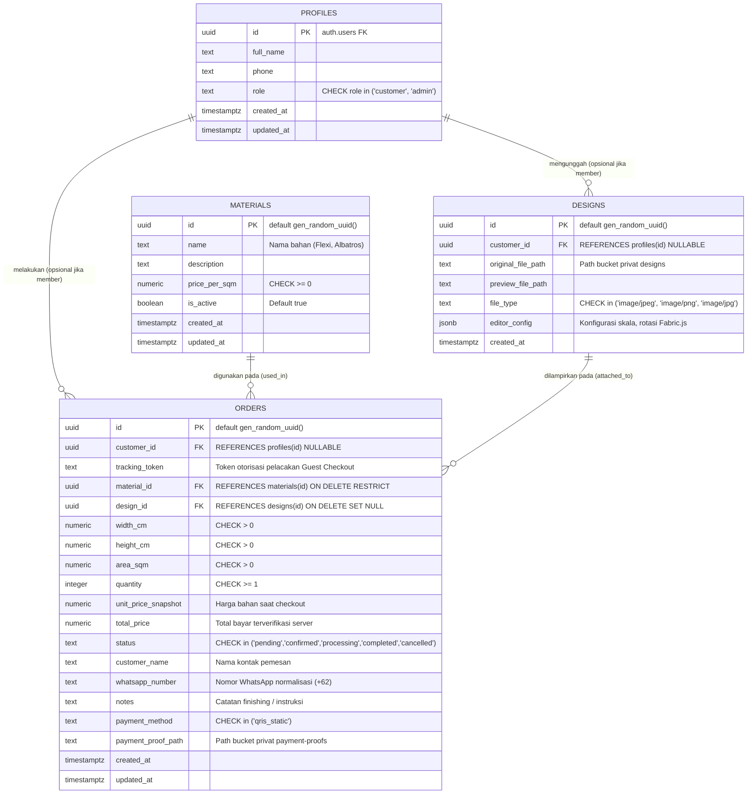

# Dokumen Perancangan Sistem Basis Data (SBD)
## Proyek: Sistem Informasi Pemesanan Banner Online (BannerIN)
## Database Engine: PostgreSQL 15+ (Hosted on Supabase Cloud)
### Arsitektur Skema: Hybrid Guest Checkout, RLS Multi-Role, & Snapshot Mutlak

---

### 1. Entity-Relationship Diagram (ERD)

Diagram relasi logis dan fisik BannerIN yang mendukung **Hybrid Guest Checkout**:

---

### 2. Kamus Data & Spesifikasi Tabel Fisik

#### 2.1 Tabel `public.profiles`
Menyimpan identitas dan hak akses (*RBAC*) yang disinkronkan otomatis dari `auth.users` Supabase saat pendaftaran.

| Nama Kolom | Tipe Data | Constraint | Keterangan |
| :--- | :--- | :--- | :--- |
| `id` | `UUID` | **PRIMARY KEY**, REFERENCES `auth.users(id)` ON DELETE CASCADE | ID unik akun terdaftar |
| `full_name` | `TEXT` | Nullable | Nama lengkap konsumen / admin |
| `phone` | `TEXT` | Nullable | Nomor WhatsApp konsumen |
| `role` | `TEXT` | NOT NULL, DEFAULT `'customer'`, CHECK (`role IN ('customer', 'admin')`) | Peran pengguna |
| `created_at` | `TIMESTAMPTZ` | NOT NULL, DEFAULT `now()` | Waktu pembuatan akun |
| `updated_at` | `TIMESTAMPTZ` | NOT NULL, DEFAULT `now()` | Waktu pembaruan profil |

---

#### 2.2 Tabel `public.materials`
Katalog master jenis bahan banner cetak digital printing beserta tarif harga per meter persegi ($\text{m}^2$).

| Nama Kolom | Tipe Data | Constraint | Keterangan |
| :--- | :--- | :--- | :--- |
| `id` | `UUID` | **PRIMARY KEY**, DEFAULT `gen_random_uuid()` | ID unik bahan |
| `name` | `TEXT` | NOT NULL | Nama bahan (Flexi 280g, Flexi Korea, Albatros, dll) |
| `description` | `TEXT` | Nullable | Karakteristik bahan (outdoor/indoor, gramasi) |
| `price_per_sqm` | `NUMERIC(12,2)`| NOT NULL, CHECK (`price_per_sqm >= 0`) | Tarif harga per meter persegi ($\text{m}^2$) |
| `is_active` | `BOOLEAN` | NOT NULL, DEFAULT `true` | Status aktif bahan untuk pemesanan baru |
| `created_at` | `TIMESTAMPTZ` | NOT NULL, DEFAULT `now()` | Waktu pencatatan bahan |
| `updated_at` | `TIMESTAMPTZ` | NOT NULL, DEFAULT `now()` | Waktu update harga terakhir |

---

#### 2.3 Tabel `public.designs`
Menyimpan metadata berkas desain banner yang diunggah pengguna ke Supabase Storage, konfigurasi editor Fabric.js, serta relasi kepemilikan.

| Nama Kolom | Tipe Data | Constraint | Keterangan |
| :--- | :--- | :--- | :--- |
| `id` | `UUID` | **PRIMARY KEY**, DEFAULT `gen_random_uuid()` | ID unik entitas desain |
| `customer_id` | `UUID` | **NULLABLE**, REFERENCES `public.profiles(id)` ON DELETE CASCADE | ID pemilik jika member; `NULL` jika pengunjung tamu |
| `original_file_path`| `TEXT` | NOT NULL | Path penyimpanan file master di bucket `designs` (`guest/*` atau `{userId}/*`) |
| `preview_file_path` | `TEXT` | Nullable | Path thumbnail / raster preview kanvas Fabric.js |
| `file_type` | `TEXT` | NOT NULL, CHECK (`file_type IN ('image/jpeg','image/png','image/jpg')`) | Format MIME type file asli |
| `editor_config` | `JSONB` | NOT NULL, DEFAULT `'{}'::jsonb` | Konfigurasi kanvas (skala, posisi X/Y, rotasi, margin) |
| `created_at` | `TIMESTAMPTZ` | NOT NULL, DEFAULT `now()` | Waktu unggah desain |

---

#### 2.4 Tabel `public.orders`
Mencatat seluruh transaksi pemesanan banner. Tabel ini menggunakan teknik **Price Snapshot** (`unit_price_snapshot`) agar perubahan harga bahan di masa depan tidak merusak riwayat transaksi lama. Pada model Hybrid, `customer_id` bersifat opsional dan dilengkapi `tracking_token`.

| Nama Kolom | Tipe Data | Constraint | Keterangan |
| :--- | :--- | :--- | :--- |
| `id` | `UUID` | **PRIMARY KEY**, DEFAULT `gen_random_uuid()` | ID transaksi (diformat jadi `#BK-...` di UI) |
| `customer_id` | `UUID` | **NULLABLE**, REFERENCES `public.profiles(id)` ON DELETE SET NULL | Akun pemesan jika member; `NULL` jika Guest Checkout |
| `tracking_token` | `TEXT` | Nullable, INDEXED | Token acak ber-entropi tinggi untuk otorisasi pelacakan tamu |
| `material_id` | `UUID` | NOT NULL, REFERENCES `public.materials(id)` ON DELETE RESTRICT | Bahan cetak yang dipilih |
| `design_id` | `UUID` | Nullable, REFERENCES `public.designs(id)` ON DELETE SET NULL | File desain yang dicetak |
| `width_cm` | `NUMERIC(8,2)` | NOT NULL, CHECK (`width_cm > 0`) | Lebar banner (cm) |
| `height_cm` | `NUMERIC(8,2)` | NOT NULL, CHECK (`height_cm > 0`) | Tinggi banner (cm) |
| `area_sqm` | `NUMERIC(10,4)`| NOT NULL, CHECK (`area_sqm > 0`) | Luas banner $(\text{lebar}/100 \times \text{tinggi}/100)$ |
| `quantity` | `INTEGER` | NOT NULL, CHECK (`quantity >= 1`) | Jumlah cetak (lembar) |
| `unit_price_snapshot`| `NUMERIC(12,2)`| NOT NULL, CHECK (`unit_price_snapshot >= 0`) | Snapshot tarif per $\text{m}^2$ saat checkout |
| `total_price` | `NUMERIC(12,2)`| NOT NULL, CHECK (`total_price >= 0`) | Total harga terhitung server $(\text{luas} \times \text{tarif} \times \text{qty})$ |
| `status` | `TEXT` | NOT NULL, DEFAULT `'pending'`, CHECK status valid | `pending`, `confirmed`, `processing`, `completed`, `cancelled` |
| `customer_name`| `TEXT` | NOT NULL | Nama pemesan untuk kontak dan pengiriman |
| `whatsapp_number` | `TEXT` | NOT NULL | Nomor WhatsApp normalisasi (+62) untuk notifikasi |
| `notes` | `TEXT` | Nullable | Catatan finishing (mata ayam, lipat keliling, dll) |
| `payment_method` | `TEXT` | NOT NULL, DEFAULT `'qris_static'`, CHECK (`'qris_static'`) | Metode bayar |
| `payment_proof_path`| `TEXT` | Nullable | Path file bukti bayar di bucket `payment-proofs` |
| `created_at` | `TIMESTAMPTZ` | NOT NULL, DEFAULT `now()` | Tanggal transaksi dibuat |
| `updated_at` | `TIMESTAMPTZ` | NOT NULL, DEFAULT `now()` | Tanggal update status |

---

### 3. Keamanan Tingkat Baris (Row Level Security / RLS)

Sistem mengamankan basis data langsung pada level mesin PostgreSQL melalui RLS:

1. **Kebijakan `designs`:**
   - **SELECT:** `customer_id IS NULL OR auth.uid() = customer_id OR public.is_admin()`
   - **INSERT:** `customer_id IS NULL OR auth.uid() = customer_id OR public.is_admin()`
   - **UPDATE:** `customer_id IS NULL OR auth.uid() = customer_id OR public.is_admin()`
2. **Kebijakan `orders`:**
   - **SELECT:** `(auth.uid() = customer_id) OR (customer_id IS NULL) OR public.is_admin()`
   - **INSERT:** `((customer_id IS NULL) OR (auth.uid() = customer_id) OR public.is_admin()) AND status = 'pending'`
   - **UPDATE:** Khusus Admin (`public.is_admin()`), konsumen dan tamu dilarang memanipulasi status atau harga pesanan yang sudah tercatat.
3. **Kebijakan Storage Buckets (`designs` & `payment-proofs`):**
   - Mengizinkan peran `anon` dan `authenticated` mengunggah file ke direktori privat `guest/*`.
   - Mengizinkan akun terdaftar mengunggah file hanya ke direktori privat berlabel `{user_id}/*`.
   - Admin memiliki hak akses baca universal ke seluruh file pesanan melalui *Signed URL*.
