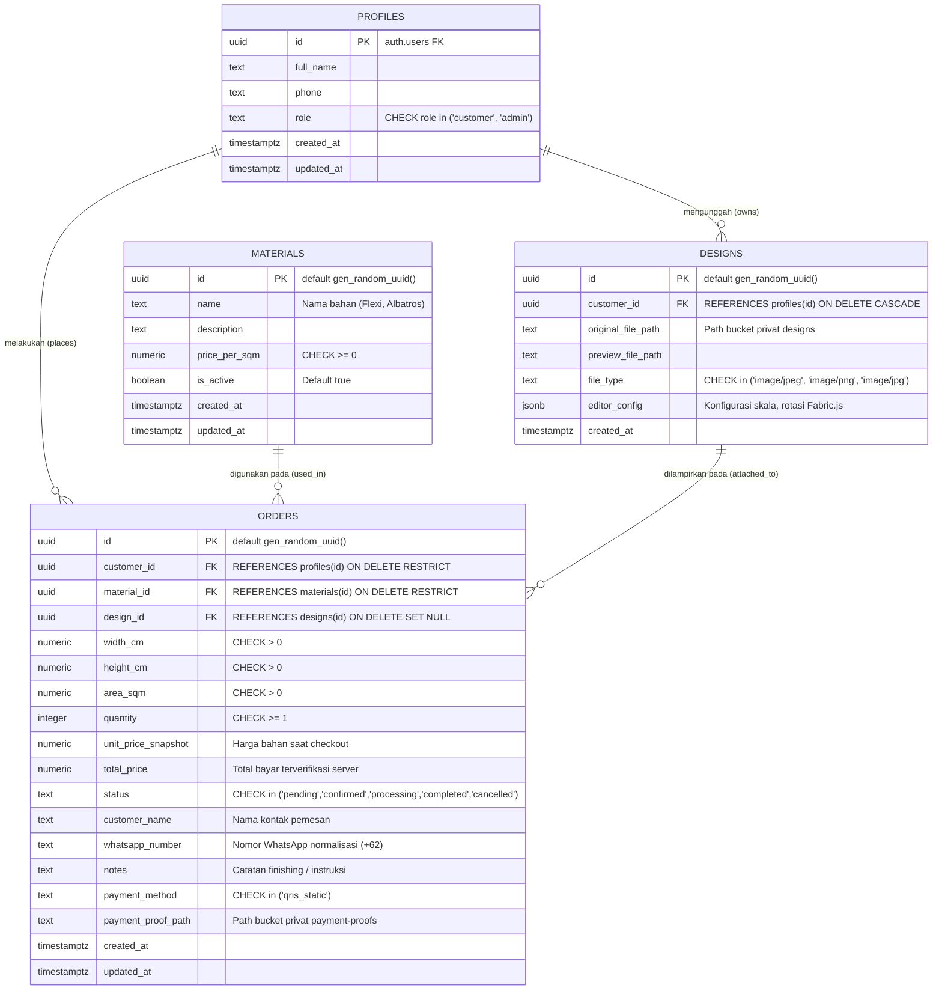

# Dokumen Perancangan Sistem Basis Data (SBD)
## Proyek: Sistem Informasi Pemesanan Banner Online (BannerIN)
## Database Engine: PostgreSQL 15+ (Hosted on Supabase Cloud)

---

### 1. Entity-Relationship Diagram (ERD)

Berikut adalah diagram relasi entitas logis dan fisik dari sistem basis data BannerIN:

---

### 2. Kamus Data & Spesifikasi Tabel Fisik

#### 2.1 Tabel `public.profiles`
Menyimpan informasi identitas dan peran (*Role-Based Access Control*) yang disinkronkan langsung dari tabel `auth.users` Supabase melalui database trigger `handle_new_user()`.

| Nama Kolom | Tipe Data | Constraint | Keterangan |
| :--- | :--- | :--- | :--- |
| `id` | `UUID` | **PRIMARY KEY**, REFERENCES `auth.users(id)` ON DELETE CASCADE | ID unik pengguna terdaftar |
| `full_name` | `TEXT` | Nullable | Nama lengkap konsumen / admin |
| `phone` | `TEXT` | Nullable | Nomor kontak WhatsApp konsumen |
| `role` | `TEXT` | NOT NULL, DEFAULT `'customer'`, CHECK (`role IN ('customer', 'admin')`) | Peran pengguna |
| `created_at` | `TIMESTAMPTZ` | NOT NULL, DEFAULT `now()` | Waktu pembuatan akun |
| `updated_at` | `TIMESTAMPTZ` | NOT NULL, DEFAULT `now()` | Waktu pembaruan profil |

---

#### 2.2 Tabel `public.materials`
Katalog master jenis bahan banner cetak digital printing beserta tarif harga per meter persegi ($\text{m}^2$).

| Nama Kolom | Tipe Data | Constraint | Keterangan |
| :--- | :--- | :--- | :--- |
| `id` | `UUID` | **PRIMARY KEY**, DEFAULT `gen_random_uuid()` | ID unik bahan |
| `name` | `TEXT` | NOT NULL | Nama bahan (mis. Flexi 280g, Flexi Korea, Albatros) |
| `description` | `TEXT` | Nullable | Karakter bahan dan peruntukan (indoor/outdoor) |
| `price_per_sqm` | `NUMERIC(12,2)`| NOT NULL, CHECK (`price_per_sqm >= 0`) | Tarif harga per meter persegi ($\text{m}^2$) |
| `is_active` | `BOOLEAN` | NOT NULL, DEFAULT `true` | Status ketersediaan bahan untuk pemesanan baru |
| `created_at` | `TIMESTAMPTZ` | NOT NULL, DEFAULT `now()` | Waktu pencatatan bahan |
| `updated_at` | `TIMESTAMPTZ` | NOT NULL, DEFAULT `now()` | Waktu update harga terakhir |

---

#### 2.3 Tabel `public.designs`
Menyimpan metadata berkas desain banner yang diunggah konsumen ke Supabase Storage, konfigurasi kanvas Fabric.js, serta relasi kepemilikan.

| Nama Kolom | Tipe Data | Constraint | Keterangan |
| :--- | :--- | :--- | :--- |
| `id` | `UUID` | **PRIMARY KEY**, DEFAULT `gen_random_uuid()` | ID unik entitas desain |
| `customer_id` | `UUID` | NOT NULL, REFERENCES `public.profiles(id)` ON DELETE CASCADE | ID pemilik desain |
| `original_file_path`| `TEXT` | NOT NULL | Path penyimpanan file master di bucket `designs` |
| `preview_file_path` | `TEXT` | Nullable | Path thumbnail / raster preview kanvas |
| `file_type` | `TEXT` | NOT NULL, CHECK (`file_type IN ('image/jpeg','image/png','image/jpg')`) | Format MIME type file asli |
| `editor_config` | `JSONB` | NOT NULL, DEFAULT `'{}'::jsonb` | State objek kanvas (skala, posisi X/Y, rotasi) |
| `created_at` | `TIMESTAMPTZ` | NOT NULL, DEFAULT `now()` | Waktu unggah desain |

---

#### 2.4 Tabel `public.orders`
Mencatat seluruh transaksi pemesanan banner. Tabel ini menggunakan teknik **Price Snapshot** (`unit_price_snapshot`), sehingga jika admin mengubah harga bahan di kemudian hari, nilai transaksi historis pesanan lama tetap tidak berubah (*immutable*).

| Nama Kolom | Tipe Data | Constraint | Keterangan |
| :--- | :--- | :--- | :--- |
| `id` | `UUID` | **PRIMARY KEY**, DEFAULT `gen_random_uuid()` | ID transaksi (diformat jadi `#BK-...` di UI) |
| `customer_id` | `UUID` | NOT NULL, REFERENCES `public.profiles(id)` ON DELETE RESTRICT | Konsumen yang memesan |
| `material_id` | `UUID` | NOT NULL, REFERENCES `public.materials(id)` ON DELETE RESTRICT | Bahan cetak yang dipilih |
| `design_id` | `UUID` | Nullable, REFERENCES `public.designs(id)` ON DELETE SET NULL | File desain yang dicetak |
| `width_cm` | `NUMERIC(8,2)` | NOT NULL, CHECK (`width_cm > 0`) | Lebar banner (cm) |
| `height_cm` | `NUMERIC(8,2)` | NOT NULL, CHECK (`height_cm > 0`) | Tinggi banner (cm) |
| `area_sqm` | `NUMERIC(10,4)`| NOT NULL, CHECK (`area_sqm > 0`) | Luas banner $(\text{lebar}/100 \times \text{tinggi}/100)$ |
| `quantity` | `INTEGER` | NOT NULL, CHECK (`quantity >= 1`) | Jumlah cetak (lembar) |
| `unit_price_snapshot`| `NUMERIC(12,2)`| NOT NULL, CHECK (`unit_price_snapshot >= 0`) | Snapshot tarif per $\text{m}^2$ saat checkout |
| `total_price` | `NUMERIC(12,2)`| NOT NULL, CHECK (`total_price >= 0`) | Total harga terhitung server $(\text{luas} \times \text{tarif} \times \text{qty})$ |
| `status` | `TEXT` | NOT NULL, DEFAULT `'pending'`, CHECK status valid | `pending`, `confirmed`, `processing`, `completed`, `cancelled` |
| `customer_name`| `TEXT` | Nullable | Nama pemesan untuk pengiriman |
| `whatsapp_number` | `TEXT` | Nullable | Nomor WhatsApp untuk konfirmasi pesanan |
| `notes` | `TEXT` | Nullable | Catatan finishing (mata ayam, lipat keliling, dll) |
| `payment_method` | `TEXT` | NOT NULL, DEFAULT `'qris_static'`, CHECK (`'qris_static'`) | Metode bayar |
| `payment_proof_path`| `TEXT` | Nullable | Path file bukti bayar di bucket `payment-proofs` |
| `created_at` | `TIMESTAMPTZ` | NOT NULL, DEFAULT `now()` | Tanggal transaksi |
| `updated_at` | `TIMESTAMPTZ` | NOT NULL, DEFAULT `now()` | Tanggal update status |

---

### 3. Keamanan Tingkat Baris: Row Level Security (RLS)

Database tidak mengandalkan filter aplikasi semata, melainkan mengunci akses langsung pada layer mesin PostgreSQL melalui RLS:

1. **Tabel `profiles`:**
   - Konsumen hanya boleh membaca dan mengubah profilnya sendiri (`auth.uid() = id`).
   - Admin memiliki akses membaca seluruh profil (`public.is_admin() = true`).
2. **Tabel `materials`:**
   - Siapa pun (termasuk publik / anon) dapat membaca bahan yang berstatus `is_active = true`.
   - Hanya Admin yang memiliki hak `INSERT`, `UPDATE`, dan `DELETE` pada katalog bahan.
3. **Tabel `designs`:**
   - Konsumen hanya dapat membaca dan memasukkan desain miliknya (`customer_id = auth.uid()`).
   - Admin dapat mengakses semua desain untuk kebutuhan pencetakan.
4. **Tabel `orders`:**
   - Konsumen hanya dapat melihat riwayat pesanannya sendiri (`customer_id = auth.uid()`). Konsumen tidak bisa melihat pesanan milik konsumen lain (**Proteksi Anti-IDOR**).
   - Admin memiliki wewenang penuh (`ALL`) untuk mengelola seluruh pesanan toko.

---

### 4. Supabase Storage Buckets (Penyimpanan Objek Privat)

BannerIN menggunakan dua bucket privat terisolasi (bukan *public URL*, melainkan diamankan dengan *Signed URL* berwaktu kedaluwarsa):
- **`designs` (Batas 20 MB):** Menerima format `image/jpeg`, `image/png`, `image/jpg`. File diisolasi di dalam folder ID konsumen masing-masing (`{customer_id}/{timestamp}_{filename}`).
- **`payment-proofs` (Batas 10 MB):** Menerima bukti transfer JPG, PNG, WEBP. Hanya dapat dilihat oleh pemilik akun dan tim Admin.

---

### 5. Analisis Normalisasi Database
- **Bentuk Normal Pertama (1NF):** Seluruh kolom bernilai atomik (tidak ada multivalue attributes), setiap tabel memiliki Primary Key unik (UUID).
- **Bentuk Normal Kedua (2NF):** Seluruh kolom non-kunci bergantung sepenuhnya pada Primary Key masing-masing tabel (tidak ada ketergantungan parsial).
- **Bentuk Normal Ketiga (3NF):** Tidak ada ketergantungan transitif. Perubahan nama atau tarif bahan di tabel `materials` tidak mengharuskan duplikasi pembaruan pada data profil pengguna, dan integritas nilai transaksi masa lalu dipertahankan melalui `unit_price_snapshot`.

