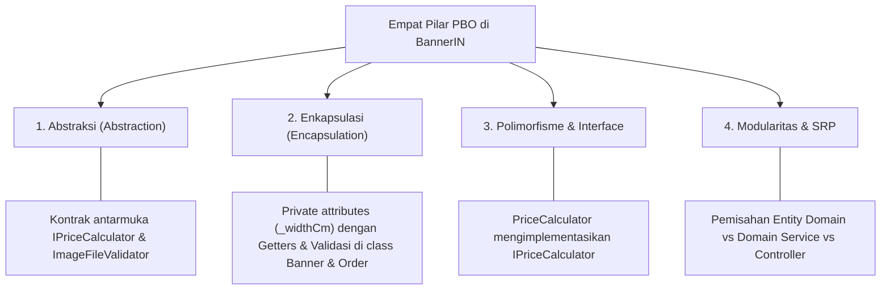

# Dokumen Penerapan Pemrograman Berbasis Objek (PBO)
## Proyek: Sistem Informasi BannerIN (TypeScript OOP)

---

### 1. Pendahuluan
Dokumen ini menjelaskan implementasi konsep **Pemrograman Berbasis Objek (PBO / OOP)** pada proyek **BannerIN**. Meskipun aplikasi dibangun dengan framework modern **Next.js** dan bahasa **TypeScript**, logika bisnis inti (*core business logic*) dirancang secara terisolasi pada direktori `src/domain/` menggunakan paradigma OOP murni.

Pendekatan ini menjamin bahwa seluruh aturan bisnis penting (seperti perhitungan tarif banner, validasi dimensi fisik, integritas pesanan, dan verifikasi berkas biner) tidak tersebar acak di komponen antarmuka pengguna (UI), melainkan terlindungi di dalam class domain yang *reusable*, *maintainable*, dan *testable* (terbukti dengan 62 unit test lulus 100%).

---

### 2. Penerapan Empat Pilar OOP di BannerIN



---

### 3. Analisis & Cuplikan Kode Nyata dari Codebase

#### 3.1 Enkapsulasi (Encapsulation) & Data Hiding
Enkapsulasi menyembunyikan detail representasi internal dari suatu objek dan hanya memperbolehkan akses melalui metode (*getter/setter/methods*) yang sah.

Pada class `Banner` ([src/domain/Banner.ts](file:///d:/BANNER-IN/bannerku/src/domain/Banner.ts)), atribut ukuran dan kuantitas dilindungi dengan modifier `private`:

```typescript
export class Banner {
  private _widthCm: number;
  private _heightCm: number;
  private _quantity: number;
  private _pricePerSqm: number;

  constructor(params: BannerDimensions & { quantity?: number; pricePerSqm?: number }) {
    this._widthCm = params.widthCm;
    this._heightCm = params.heightCm;
    this._quantity = params.quantity ?? 1;
    this._pricePerSqm = params.pricePerSqm ?? 0;

    // Menjalankan validasi otomatis saat objek diinisialisasi
    this.validate();
  }

  // Getter terkontrol tanpa sembarang mutasi dari luar
  public get widthCm(): number { return this._widthCm; }
  public get heightCm(): number { return this._heightCm; }
  public get quantity(): number { return this._quantity; }
  public get pricePerSqm(): number { return this._pricePerSqm; }

  // Aturan Bisnis Terenkapsulasi: Validasi batas fisik banner cetak
  public validate(): void {
    if (this._widthCm <= 0 || this._heightCm <= 0) {
      throw new Error("Dimensi banner harus bernilai positif lebih dari 0.");
    }
    if (this._widthCm < 10 || this._heightCm < 10) {
      throw new Error("Ukuran minimum banner adalah 10 cm.");
    }
    if (this._widthCm > 5000 || this._heightCm > 5000) {
      throw new Error("Ukuran maksimum banner adalah 5000 cm (50 meter).");
    }
    if (!Number.isInteger(this._quantity) || this._quantity < 1) {
      throw new Error("Jumlah pesanan (quantity) harus berupa bilangan bulat minimal 1.");
    }
  }

  // Perhitungan Luas (m2) sesuai rumus baku percetakan
  public calculateAreaSqm(): number {
    const area = (this._widthCm / 100) * (this._heightCm / 100);
    return Math.round(area * 10000) / 10000;
  }
}
```

*Keuntungan Enkapsulasi:*
- Mencegah *state invalid* seperti dimensi negatif, angka desimal pada kuantitas pesanan, atau manipulasi objek di luar aturan percetakan.

---

#### 3.2 Abstraksi (Abstraction) & Interface Segregation
Abstraksi memisahkan antara **apa** yang dilakukan sistem dengan **bagaimana** sistem melakukannya. 

BannerIN mendefinisikan kontrak kalkulasi harga melalui interface `IPriceCalculator` ([src/domain/IPriceCalculator.ts](file:///d:/BANNER-IN/bannerku/src/domain/IPriceCalculator.ts)):

```typescript
export interface PriceCalculationResult {
  widthCm: number;
  heightCm: number;
  areaSqm: number;
  pricePerSqm: number;
  quantity: number;
  subtotalPerUnit: number;
  totalPrice: number;
  breakdown: string;
}

export interface IPriceCalculator {
  calculate(banner: Banner): PriceCalculationResult;
  calculateFromDimensions(
    widthCm: number,
    heightCm: number,
    pricePerSqm: number,
    quantity?: number
  ): PriceCalculationResult;
}
```

Implementasi konkret interface tersebut diwujudkan di class `PriceCalculator` ([src/domain/PriceCalculator.ts](file:///d:/BANNER-IN/bannerku/src/domain/PriceCalculator.ts)):

```typescript
export class PriceCalculator implements IPriceCalculator {
  public calculate(banner: Banner): PriceCalculationResult {
    const areaSqm = banner.calculateAreaSqm();
    const subtotalPerUnit = Math.round(areaSqm * banner.pricePerSqm);
    const totalPrice = subtotalPerUnit * banner.quantity;

    return {
      widthCm: banner.widthCm,
      heightCm: banner.heightCm,
      areaSqm,
      pricePerSqm: banner.pricePerSqm,
      quantity: banner.quantity,
      subtotalPerUnit,
      totalPrice,
      breakdown: `(${banner.widthCm}/100 m × ${banner.heightCm}/100 m) = ${areaSqm} m² × Rp${banner.pricePerSqm.toLocaleString("id-ID")} × ${banner.quantity} pcs = Rp${totalPrice.toLocaleString("id-ID")}`
    };
  }
}
```

*Keuntungan Abstraksi:*
- Memungkinkan penggantian skema kalkulasi di masa depan (misalnya penambahan diskon berjenjang atau kupon grosir) tanpa mengubah kode antarmuka yang mengonsumsi interface tersebut.

---

#### 3.3 Domain Model Keamanan & Isolasi (Anti-IDOR)
Class `Order` ([src/domain/Order.ts](file:///d:/BANNER-IN/bannerku/src/domain/Order.ts)) mengenkapsulasi status transaksi, nomor invoice unik `#BK`, serta proteksi akses kepemilikan (*Insecure Direct Object Reference / Anti-IDOR*):

```typescript
export class Order {
  private _id: string;
  private _customerId: string;
  private _status: OrderStatus;
  private _totalPrice: number;

  constructor(data: OrderEntityData) {
    this._id = data.id;
    this._customerId = data.customerId;
    this._status = data.status;
    this._totalPrice = data.totalPrice;
  }

  // Verifikasi Kepemilikan (Anti-IDOR): Konsumen tidak boleh melihat pesanan orang lain
  public isOwnedBy(userId: string): boolean {
    return !!userId && this._customerId === userId;
  }

  // Aturan transisi status: Pembatalan hanya boleh dilakukan jika pesanan masih pending
  public canBeCancelled(): boolean {
    return this._status === "pending";
  }

  // Pembentukan nomor invoice profesional #BK dari UUID
  public formatOrderNumber(): string {
    const cleanId = this._id.replace(/-/g, "").toUpperCase();
    return `#BK-${cleanId.slice(0, 8)}`;
  }
}
```

---

#### 3.4 Validasi Biner File Menggunakan Class Helper (Magic Bytes)
Class `ImageFileValidator` ([src/domain/ImageFileValidator.ts](file:///d:/BANNER-IN/bannerku/src/domain/ImageFileValidator.ts)) melindungi sistem dari serangan injeksi berkas berbahaya (seperti file executable `.exe` atau skrip yang sengaja diganti namanya menjadi `.png` atau `.jpg`):

```typescript
export class ImageFileValidator {
  // Memeriksa header biner asli (magic numbers)
  public static verifyMagicBytes(bytes: Uint8Array, mimeType: string): boolean {
    // Magic Bytes JPEG: FF D8 FF
    if (mimeType === "image/jpeg" || mimeType === "image/jpg") {
      return bytes.length >= 3 && bytes[0] === 0xFF && bytes[1] === 0xD8 && bytes[2] === 0xFF;
    }
    // Magic Bytes PNG: 89 50 4E 47 0D 0A 1A 0A
    if (mimeType === "image/png") {
      return bytes.length >= 8 &&
        bytes[0] === 0x89 && bytes[1] === 0x50 && bytes[2] === 0x4E && bytes[3] === 0x47 &&
        bytes[4] === 0x0D && bytes[5] === 0x0A && bytes[6] === 0x1A && bytes[7] === 0x0A;
    }
    return false;
  }
}
```

---

### 4. Manfaat Penerapan OOP pada Proyek BannerIN
1. **Pemisahan Tanggung Jawab (Separation of Concerns):** Komponen React hanya bertugas menampilkan UI, sedangkan perhitungan rupiah, validasi luas, dan aturan bisnis mutlak diolah oleh class domain.
2. **Keamanan Server-Authoritative (Anti-Manipulasi):** Konsumen tidak bisa memanipulasi harga melalui *Inspect Element* browser, karena class `OrderService` di server selalu menghitung ulang total harga menggunakan instance `Banner` dan `PriceCalculator` dengan data bahan asli dari database.
3. **Kemudahan Pengujian (Testability):** Karena domain model murni tidak bergantung pada browser DOM maupun koneksi database langsung, seluruh logika bisnis dapat diuji secara instan dengan framework uji Node.js (`test/Fase13Matrix.test.ts`), menghasilkan 62 pengujian sukses dalam waktu kurang dari 500 ms.

