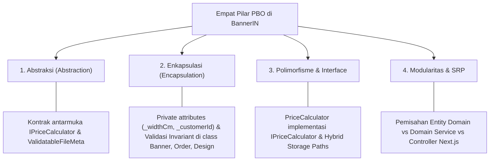

# Dokumen Penerapan Pemrograman Berbasis Objek (PBO)
## Proyek: Sistem Informasi BannerIN (TypeScript OOP)
### Topik Khusus: Domain-Driven Design, 4 Pilar OOP, & Hybrid Guest Checkout

---

### 1. Pendahuluan
Dokumen ini menjelaskan implementasi konsep **Pemrograman Berbasis Objek (PBO / OOP)** pada proyek **BannerIN**. Meskipun aplikasi dibangun dengan framework modern **Next.js** dan bahasa **TypeScript**, logika bisnis inti (*core business logic*) dirancang secara terisolasi pada direktori `src/domain/` menggunakan paradigma OOP murni.

Pendekatan ini menjamin bahwa seluruh aturan bisnis penting (seperti perhitungan tarif banner, validasi dimensi fisik, integritas pesanan, model Guest Checkout Hybrid, dan verifikasi berkas biner) tidak tersebar acak di komponen antarmuka pengguna (UI), melainkan terlindungi di dalam class domain yang *reusable*, *maintainable*, dan *testable* (terbukti dengan **70 unit test lulus 100%**).

---

### 2. Penerapan Empat Pilar OOP di BannerIN



---

### 3. Analisis & Cuplikan Kode Nyata dari Codebase

#### 3.1 Enkapsulasi (Encapsulation) & Data Invariant
Enkapsulasi menyembunyikan detail representasi internal dari suatu objek dan hanya memperbolehkan akses melalui metode (*getter/methods*) yang sah.

Pada class `Banner` ([src/domain/Banner.ts](file:///d:/BANNER-IN/bannerku/src/domain/Banner.ts)), atribut ukuran dan kuantitas dilindungi dengan modifier `private` dan diuji terhadap invarian bisnis percetakan:

```typescript
export class Banner {
  private _widthCm: number;
  private _heightCm: number;
  private _quantity: number;

  constructor(widthCm: number, heightCm: number, quantity: number = 1) {
    this._widthCm = widthCm;
    this._heightCm = heightCm;
    this._quantity = quantity;
    this.validate(); // Menjamin objek yang tercipta selalu berada pada status valid
  }

  public get widthCm(): number { return this._widthCm; }
  public get heightCm(): number { return this._heightCm; }
  public get quantity(): number { return this._quantity; }

  public validate(): void {
    if (this._widthCm <= 0 || this._heightCm <= 0) {
      throw new Error("Dimensi banner harus lebih besar dari 0.");
    }
    if (this._widthCm < Banner.MIN_DIMENSION_CM || this._heightCm < Banner.MIN_DIMENSION_CM) {
      throw new Error(`Dimensi banner minimal ${Banner.MIN_DIMENSION_CM} cm.`);
    }
    if (this._widthCm > Banner.MAX_DIMENSION_CM || this._heightCm > Banner.MAX_DIMENSION_CM) {
      throw new Error(`Dimensi banner maksimal ${Banner.MAX_DIMENSION_CM} cm.`);
    }
    if (!Number.isInteger(this._quantity) || this._quantity < Banner.MIN_QUANTITY) {
      throw new Error(`Jumlah cetak minimal ${Banner.MIN_QUANTITY} dan harus bilangan bulat.`);
    }
  }

  public getArea(): number {
    return Number(((this._widthCm * this._heightCm) / 10000).toFixed(4));
  }
}
```

*Keuntungan Enkapsulasi:*
- Mencegah *state invalid* seperti dimensi bernilai 0 atau negatif, angka desimal pada kuantitas pesanan, atau ukuran melebihi kapasitas mesin cetak digital printing (50 meter).

---

#### 3.2 Abstraksi (Abstraction) & Interface Segregation
Abstraksi memisahkan antara **apa** yang dilakukan sistem dengan **bagaimana** sistem melakukannya secara teknis. 

BannerIN mendefinisikan kontrak kalkulasi harga melalui interface `IPriceCalculator` ([src/domain/IPriceCalculator.ts](file:///d:/BANNER-IN/bannerku/src/domain/IPriceCalculator.ts)):

```typescript
export interface PriceBreakdown {
  widthCm: number;
  heightCm: number;
  areaSqm: number;
  pricePerSqm: number;
  quantity: number;
  unitPrice: number;
  totalPrice: number;
  formulaDescription: string;
}

export interface IPriceCalculator {
  calculateTotal(params: PriceCalculationParams): number;
  calculateBreakdown(params: PriceCalculationParams): PriceBreakdown;
}
```

Implementasi konkret interface tersebut diwujudkan di class `PriceCalculator` ([src/domain/PriceCalculator.ts](file:///d:/BANNER-IN/bannerku/src/domain/PriceCalculator.ts)):

```typescript
export class PriceCalculator implements IPriceCalculator {
  public calculateBreakdown(params: PriceCalculationParams): PriceBreakdown {
    const banner = new Banner(params.widthCm, params.heightCm, params.quantity);
    const areaSqm = banner.getArea();
    const unitPrice = Math.ceil(areaSqm * params.pricePerSqm);
    const totalPrice = Math.ceil(unitPrice * banner.quantity);

    return {
      widthCm: banner.widthCm,
      heightCm: banner.heightCm,
      areaSqm,
      pricePerSqm: params.pricePerSqm,
      quantity: banner.quantity,
      unitPrice,
      totalPrice,
      formulaDescription: `(${banner.widthCm} × ${banner.heightCm} cm) = ${areaSqm} m² × Rp${params.pricePerSqm.toLocaleString("id-ID")} × ${banner.quantity} pcs = Rp${totalPrice.toLocaleString("id-ID")}`
    };
  }
}
```

*Keuntungan Abstraksi:*
- Memungkinkan penambahan strategi kalkulasi baru di masa depan (misal: diskon grosir bertingkat, kupon promo musiman, atau margin bahan khusus) tanpa mengubah kode client pemanggil (*Open/Closed Principle*).

---

#### 3.3 Penanganan Model Hybrid Guest Checkout pada Objek Domain
Pada model **Guest Checkout (Hybrid)**, entitas `Order` dan `Design` dirancang untuk mendukung relasi opsional dengan pelanggan:

Pada class `Order` ([src/domain/Order.ts](file:///d:/BANNER-IN/bannerku/src/domain/Order.ts)):
```typescript
export class Order {
  public readonly id?: string;
  public readonly customerId: string | null;      // NULL untuk Guest Checkout
  public readonly trackingToken?: string | null;  // Token otorisasi pelacakan tanpa sesi login
  public readonly customerName: string;           // Selalu divalidasi (2-100 karakter)
  public readonly whatsappNumber: string;         // Dinormalisasi ke E.164 (+62...)
  public readonly totalPrice: number;             // Dihitung ulang oleh server (authoritative)
  public readonly status: OrderStatus;            // Pending -> Confirmed -> Processing -> Completed

  constructor(props: OrderProps) {
    // Validasi dimensi, harga snapshot, nama, dan nomor WA tetap wajib
    this.customerId = props.customerId ? props.customerId.trim() : null;
    this.trackingToken = props.trackingToken ? props.trackingToken.trim() : null;
    this.customerName = Order.normalizeCustomerName(props.customerName);
    this.whatsappNumber = Order.normalizeWhatsApp(props.whatsappNumber).e164;
    // ...
  }

  // Verifikasi jalur bukti bayar: folder guest/ untuk tamu, {userId}/ untuk akun terdaftar
  public static validatePaymentProofPath(
    customerId: string | null | undefined,
    rawPath?: string | null
  ): string | null {
    if (!rawPath) return null;
    const cleanPath = rawPath.trim();
    if (cleanPath.includes("..")) throw new Error("Path bukti pembayaran tidak valid.");
    
    if (customerId) {
      if (!cleanPath.startsWith(`${customerId}/`)) {
        throw new Error("Path bukti pembayaran harus berada di direktori milik pengguna.");
      }
    } else {
      if (!cleanPath.startsWith("guest/")) {
        throw new Error("Path bukti pembayaran tamu harus berada di direktori guest.");
      }
    }
    return cleanPath;
  }
}
```

---

#### 3.4 Validasi Biner File Menggunakan Class Helper (Magic Bytes)
Class `ImageFileValidator` ([src/domain/ImageFileValidator.ts](file:///d:/BANNER-IN/bannerku/src/domain/ImageFileValidator.ts)) melindungi sistem dari serangan manipulasi ekstensi (*MIME spoofing*):

```typescript
export class ImageFileValidator {
  public static detectImageFormatByMagicBytes(bytes: Uint8Array): "image/jpeg" | "image/png" | null {
    // Magic Bytes JPEG: FF D8 FF
    if (bytes.length >= 3 && bytes[0] === 0xFF && bytes[1] === 0xD8 && bytes[2] === 0xFF) {
      return "image/jpeg";
    }
    // Magic Bytes PNG: 89 50 4E 47 0D 0A 1A 0A
    if (bytes.length >= 8 &&
        bytes[0] === 0x89 && bytes[1] === 0x50 && bytes[2] === 0x4E && bytes[3] === 0x47 &&
        bytes[4] === 0x0D && bytes[5] === 0x0A && bytes[6] === 0x1A && bytes[7] === 0x0A) {
      return "image/png";
    }
    return null;
  }
}
```

---

### 4. Manfaat Penerapan OOP pada Proyek BannerIN
1. **Pemisahan Tanggung Jawab (Separation of Concerns):** Komponen React hanya bertugas menampilkan UI, sedangkan perhitungan rupiah, validasi luas, dan aturan bisnis mutlak diolah oleh class domain.
2. **Keamanan Server-Authoritative (Anti-Manipulasi):** Konsumen tidak bisa memanipulasi harga melalui *Inspect Element* browser, karena class `OrderService` di server selalu menghitung ulang total harga menggunakan instance `Banner` dan `PriceCalculator` dengan data bahan aktif dari database.
3. **Fleksibilitas Bisnis (Hybrid Checkout):** Objek domain mampu menangani transaksi anonim (*Guest*) maupun anggota (*Registered*) dengan konsistensi validasi yang sama persis tanpa perlu menduplikasi kode.
4. **Kemudahan Pengujian (Testability):** Logika bisnis murni tidak bergantung pada browser DOM maupun koneksi database langsung, sehingga dapat diuji secara instan dengan Node.js Test Runner, menghasilkan **70 pengujian sukses (100% PASS)** dalam waktu 500 ms.
