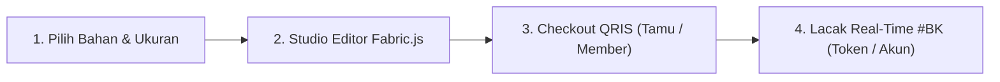

# Panduan Presentasi & Pitch Deck BannerIN
## Panduan Lengkap untuk Mempresentasikan Proyek ke Dosen Penguji, Rekan Mahasiswa, atau Khalayak Umum / Calon Investor

---

### 1. Profil Singkat & Elevator Pitch (30 Detik)

> *"Selamat pagi/siang bapak/ibu dosen dan rekan-rekan sekalian. Perkenalkan, saya **Arya Raka Permana**, pengembang dari **BannerIN** — Platform Web Pemesanan Banner dan Digital Printing Modern.*  
> *BannerIN hadir untuk memecahkan masalah percetakan tradisional yang lambat dan penuh miskomunikasi, dengan menghadirkan kalkulator harga instan berbasis rumus baku percetakan, editor preview desain interaktif langsung di browser, transaksi QRIS otomatis, model **Guest Checkout Hybrid** yang menghilangkan hambatan pendaftaran, serta dashboard pelacakan pesanan real-time dari meja kerja hingga mesin cetak."*

---

### 2. Latar Belakang & Masalah (The Pain Points)
Ketika konsumen ingin mencetak spanduk/banner secara konvensional, ada 4 hambatan besar:
1. **Tanya-Jawab Harga yang Melelahkan:** Konsumen harus chat WhatsApp berulang kali menanyakan *"Kalau ukuran 3x1 meter bahan Flexi berapa harganya?"*.
2. **Kekhawatiran Desain Terpotong:** Konsumen bingung apakah desainnya pas dengan rasio spanduk yang diinginkan atau malah terkena lubang mata ayam (*grommet*).
3. **Friksi Pendaftaran Akun (Cart Abandonment):** Pada kebutuhan mendesak, mewajibkan pelanggan membuat akun dan verifikasi email memicu pembatalan pesanan hingga 40%.
4. **Ketidakpastian Status Cetak:** Konsumen sering bertanya *"Apakah banner saya sudah dicetak? Kapan bisa diambil?"* tanpa kejelasan nomor antrean.

---

### 3. Solusi Inovatif dari BannerIN (The Value Proposition)

1. **Transparansi Rumus Harga Otomatis:**
   Sistem secara otomatis menghitung $\text{Luas (m}^2) = \frac{P}{100} \times \frac{L}{100}$, dikalikan tarif bahan resmi Supabase. Tidak ada markup tersembunyi.
2. **Studio Desain Interaktif (Fabric.js Canvas Engine):**
   Konsumen dapat mengunggah gambar JPG/PNG, melihat tampilan kanvas sesuai rasio banner aslinya ($P:L$), menggeser, memperbesar, serta mengaktifkan garis aman potong (*safe margin*) dan preview titik mata ayam.
3. **Model Hybrid Guest Checkout:**
   Menghilangkan friksi pendaftaran akun. Pengunjung dapat langsung memesan (*guest checkout*) dan menerima tautan pelacakan instan (`tracking_token`), sementara pelanggan setia tetap bisa login untuk menyimpan riwayat pesanan terpusat.
4. **Keamanan Transaksi & Anti-Manipulasi:**
   Perhitungan harga bersifat *server-authoritative* (kebal manipulasi inspeksi browser), dilengkapi verifikasi biner (*magic bytes*) file asli.
5. **Pelacakan Status Stepper 4 Tahap:**
   Konsumen memantau progress secara transparan: **Menunggu Konfirmasi $\to$ Dikonfirmasi $\to$ Sedang Dicetak $\to$ Selesai**.

---

### 4. Skenario Demo Aplikasi (Alur Presentasi 5–7 Menit)

#### Langkah 1: Landing Page & Katalog Bahan (1 Menit)
- Tampilkan landing page [BannerIN](http://localhost:3000/).
- Sorot foto-foto asli percetakan (Banner Custom mesin digital printing, Roll Banner pameran, X-Banner promosi toko).
- Buka kalkulator interaktif di landing page atau menu Katalog Bahan (`/materials`). Tunjukkan bahwa harga berubah dinamis saat ukuran atau bahan diganti.

#### Langkah 2: Studio Desain Interaktif (`/studio`) (2 Menit)
- Buka Studio Editor tanpa login (Mode Tamu). Masukkan ukuran misalnya `300 × 100 cm` (rasio spanduk outdoor).
- Unggah sebuah gambar desain.
- Tunjukkan fitur Fabric.js:
  - Kanvas langsung menyesuaikan rasio 3:1 secara proporsional.
  - Gambar bisa digeser dan diubah ukurannya secara bebas.
  - Aktifkan toggle **Garis potong & mata ayam** untuk mendemonstrasikan fitur panduan cetak aman.
- Klik tombol **Pilih & Unggah File Desain** lalu **Lanjut ke Pembayaran**. Sistem tidak memblokir tamu!

#### Langkah 3: Alur Guest Checkout & Pembayaran QRIS (`/checkout`) (1.5 Menit)
- Tunjukkan bahwa halaman checkout dapat diakses langsung oleh tamu tanpa dipaksa login (*Guest Mode*).
- Masukkan Nama Lengkap dan Nomor WhatsApp.
- Tunjukkan ringkasan pesanan dengan rincian luas, bahan, dan harga yang terhitung presisi.
- Tunjukkan kode QRIS statis resmi toko dan tombol unduh QR.
- Unggah file foto bukti transfer.
- Klik **Konfirmasi Pembayaran**. Sistem menerbitkan nomor transaksi unik `#BK-...` beserta **Tautan Pelacakan Pesanan Instan** (`/customer/orders/[id]?token=...`).

#### Langkah 4: Pelacakan Pesanan & Invoice (1 Menit)
- Buka tautan pelacakan tamu. Tunjukkan bahwa status pesanan dapat dipantau langsung tanpa akun.
- Tunjukkan tombol cetak invoice transaksi resmi.
- Buka portal member (`/customer/dashboard`) untuk menunjukkan perbedaan: member memiliki riwayat akumulatif multi-pesanan.

#### Langkah 5: Dashboard Administrator (`/dashboard`) (1.5 Menit)
- Buka tab/jendela admin. Tunjukkan ringkasan metrik (Pesanan Hari Ini, Omset, Perlu Konfirmasi).
- Buka pesanan tamu yang baru saja dibuat. Tunjukkan bahwa data pemesan (nama dan WhatsApp) tercatat lengkap.
- Tunjukkan modal **Lihat Bukti Bayar** (memverifikasi transfer asli).
- Klik tombol **Unduh Desain Asli** (menjelaskan bahwa file diunduh langsung dari Supabase Storage privat dengan Signed URL untuk diproses ke mesin cetak).
- Ubah status dari `Menunggu Konfirmasi` $\to$ `Dikonfirmasi` $\to$ `Sedang Produksi` $\to$ `Selesai`.
- Buka kembali tautan pelacakan tamu: Status langsung tersinkronisasi menjadi selesai!

---

### 5. Keunggulan Teknis untuk Menjawab Pertanyaan Penguji (Q&A)

| Pertanyaan Penguji | Jawaban Strategis BannerIN |
| :--- | :--- |
| *Mengapa memilih model Hybrid Guest Checkout daripada mewajibkan akun?* | **Meningkatkan Conversion Rate bisnis.** Berdasarkan riset e-commerce, 40% calon pelanggan membatalkan pesanan jika dipaksa membuat akun pada kebutuhan mendesak. Model Hybrid memberikan kemudahan instan bagi pengguna kasual via *tracking token*, namun tetap memfasilitasi pelanggan korporat/langganan untuk memiliki akun riwayat. |
| *Bagaimana keamanan pesanan tamu agar tidak diintip orang lain (Anti-IDOR)?* | Setiap pesanan tamu menghasilkan **`tracking_token` cryptographically secure** (UUID v4 / crypto random). Pelacakan pesanan hanya dapat diakses oleh pihak yang memegang token tersebut atau administrator percetakan. |
| *Bagaimana jika pengguna sengaja mengedit HTML harga jadi Rp 1 sebelum bayar?* | **Kebal manipulasi.** Server Actions di backend selalu menghitung ulang total harga menggunakan formula domain OOP murni dan mengambil harga bahan langsung dari Supabase. Input manipulatif dari browser diabaikan. |
| *Bagaimana jika ada yang mengunggah file virus `.exe` yang diubah jadi `.png`?* | **Dilindungi validasi Magic Bytes.** Sistem memeriksa header biner asli file (`0x89 0x50 0x4E 0x47` untuk PNG dan `0xFF 0xD8 0xFF` untuk JPEG). Berkas palsu ditolak otomatis baik di sisi client maupun server. |
| *Bagaimana pengujian sistem ini dilakukan?* | Sistem dilengkapi test suite terotomatisasi dengan **70 skenario pengujian unit & integrasi** (`npm test`), mencakup 15 matriks kebutuhan fungsional SRS dan pengujian Guest Checkout dengan hasil **100% PASS**. |
| *Bagaimana keamanan data antar konsumen terdaftar?* | Dilindungi oleh **Row Level Security (RLS)** pada level PostgreSQL di Supabase. Konsumen hanya bisa melihat dan membaca baris datanya sendiri. |

---

### 6. Kalimat Penutup Presentasi

> *"Dengan perpaduan arsitektur Clean Code OOP, performa tinggi Next.js 16, kanvas interaktif Fabric.js, kemudahan Guest Checkout Hybrid, dan keamanan enterprise dari PostgreSQL Supabase, **BannerIN** membuktikan bahwa perancangan sistem informasi dapat diwujudkan menjadi solusi digital printing nyata yang siap dioperasikan dan bernilai bisnis tinggi. Terima kasih atas perhatian bapak/ibu dosen dan rekan-rekan sekalian."*
