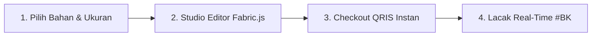

# Panduan Presentasi & Pitch Deck BannerIN
## Panduan Lengkap untuk Mempresentasikan Proyek ke Dosen Penguji, Rekan Mahasiswa, atau Khalayak Umum / Calon Investor

---

### 1. Profil Singkat & Elevator Pitch (30 Detik)

> *"Selamat pagi/siang bapak/ibu dosen dan rekan-rekan sekalian. Perkenalkan, saya **Arya Raka Permana**, pengembang dari **BannerIN** — Platform Web Pemesanan Banner dan Digital Printing Modern.*  
> *BannerIN hadir untuk memecahkan masalah percetakan tradisional yang lambat dan penuh miskomunikasi, dengan menghadirkan kalkulator harga instan berbasis rumus baku percetakan, editor preview desain interaktif langsung di browser, transaksi QRIS otomatis, serta dashboard pelacakan pesanan real-time dari meja kerja hingga mesin cetak."*

---

### 2. Latar Belakang & Masalah (The Pain Points)
Ketika konsumen ingin mencetak spanduk/banner secara konvensional, ada 3 hambatan besar:
1. **Tanya-Jawab Harga yang Melelahkan:** Konsumen harus chat WhatsApp berulang kali menanyakan *"Kalau ukuran 3x1 meter bahan Flexi berapa harganya?"*.
2. **Kekhawatiran Desain Terpotong:** Konsumen bingung apakah desainnya pas dengan rasio spanduk yang diinginkan atau malah terkena lubang mata ayam (*grommet*).
3. **Ketidakpastian Status Cetak:** Konsumen sering bertanya *"Apakah banner saya sudah dicetak? Kapan bisa diambil?"* tanpa kejelasan nomor antrean.

---

### 3. Solusi Inovatif dari BannerIN (The Value Proposition)

1. **Transparansi Rumus Harga Otomatis:**
   Sistem secara otomatis menghitung $\text{Luas (m}^2) = \frac{P}{100} \times \frac{L}{100}$, dikalikan tarif bahan resmi Supabase. Tidak ada harga tersembunyi.
2. **Studio Desain Interaktif (Fabric.js Canvas Engine):**
   Konsumen dapat mengunggah gambar JPG/PNG, melihat tampilan kanvas sesuai rasio banner aslinya ($P:L$), menggeser, memperbesar, serta mengaktifkan garis aman potong (*safe margin*) dan preview titik mata ayam.
3. **Keamanan Transaksi & Anti-Manipulasi:**
   Perhitungan harga bersifat *server-authoritative* (kebal manipulasi inspeksi browser), dilengkapi verifikasi biner (*magic bytes*) file asli.
4. **Pelacakan Status Stepper 4 Tahap:**
   Konsumen memantau progress secara transparan: **Menunggu Konfirmasi $\to$ Dikonfirmasi $\to$ Sedang Dicetak $\to$ Selesai**.

---

### 4. Skenario Demo Aplikasi (Alur Presentasi 5–7 Menit)

#### Langkah 1: Landing Page & Katalog Bahan (1 Menit)
- Tampilkan landing page [BannerIN](http://localhost:3000/).
- Sorot foto-foto asli percetakan (Banner Custom mesin digital printing, Roll Banner pameran, X-Banner promosi toko).
- Buka kalkulator interaktif di landing page atau menu Katalog Bahan (`/materials`). Tunjukkan bahwa harga berubah dinamis saat ukuran atau bahan diganti.

#### Langkah 2: Studio Desain Interaktif (`/studio`) (2 Menit)
- Buka Studio Editor. Masukkan ukuran misalnya `300 × 100 cm` (rasio spanduk outdoor).
- Unggah sebuah gambar desain.
- Tunjukkan fitur Fabric.js:
  - Kanvas langsung menyesuaikan rasio 3:1 secara proporsional.
  - Gambar bisa digeser dan diubah ukurannya secara bebas.
  - Aktifkan toggle **Garis potong & mata ayam** untuk mendemonstrasikan fitur panduan cetak aman.
- Klik tombol **Pesan Sekarang**.

#### Langkah 3: Alur Checkout & Pembayaran QRIS (`/checkout`) (1.5 Menit)
- Tunjukkan ringkasan pesanan dengan rincian luas, bahan, dan harga yang terhitung presisi.
- Tunjukkan kode QRIS statis resmi toko dan tombol unduh QR.
- Unggah file foto bukti transfer.
- Klik **Konfirmasi Pembayaran**. Sistem menerbitkan nomor transaksi unik, misalnya `#BK-A1B2C3D4`.

#### Langkah 4: Portal Konsumen (`/customer/dashboard`) (1 Menit)
- Tunjukkan dashboard konsumen. Pesanan baru langsung tampil dengan status `Menunggu Konfirmasi` dan timeline 4 langkah.
- Tunjukkan detail pesanan dan tombol cetak invoice resmi.
- Demonstrasikan keamanan: Konsumen tidak dapat mengakses pesanan konsumen lain (Anti-IDOR).

#### Langkah 5: Dashboard Administrator (`/dashboard`) (1.5 Menit)
- Buka tab/jendela admin. Tunjukkan ringkasan metrik (Pesanan Hari Ini, Omset, Perlu Konfirmasi).
- Buka pesanan yang baru saja dibuat konsumen.
- Tunjukkan modal **Lihat Bukti Bayar** (memverifikasi transfer asli).
- Klik tombol **Unduh Desain Asli** (menjelaskan bahwa file diunduh langsung dari Supabase Storage privat dengan Signed URL untuk dicetak ke mesin).
- Ubah status dari `Menunggu Konfirmasi` $\to$ `Dikonfirmasi` $\to$ `Sedang Produksi` $\to$ `Selesai`.
- Kembali ke halaman konsumen: Status langsung tersinkronisasi menjadi selesai!

---

### 5. Keunggulan Teknis untuk Menjawab Pertanyaan Penguji (Q&A)

| Pertanyaan Penguji | Jawaban Strategis BannerIN |
| :--- | :--- |
| *Bagaimana jika pengguna sengaja mengedit HTML harga jadi Rp 1 sebelum bayar?* | **Kebal manipulasi.** Server Actions di backend selalu menghitung ulang total harga menggunakan formula domain OOP murni dan mengambil harga bahan langsung dari Supabase. Input manipulatif dari browser diabaikan. |
| *Bagaimana jika ada yang mengunggah file virus `.exe` yang diubah jadi `.png`?* | **Dilindungi validasi Magic Bytes.** Sistem tidak hanya memeriksa ekstensi nama file, tetapi memeriksa header biner asli file (`0x89 0x50 0x4E 0x47` untuk PNG dan `0xFF 0xD8 0xFF` untuk JPEG). Berkas palsu ditolak otomatis. |
| *Bagaimana pengujian sistem ini dilakukan?* | Sistem dilengkapi test suite terotomatisasi dengan **62 skenario pengujian unit & integrasi** (`npm test`), mencakup 15 matriks kebutuhan fungsional SRS dengan hasil **100% PASS**. |
| *Bagaimana keamanan data antar konsumen?* | Dilindungi oleh **Row Level Security (RLS)** pada level PostgreSQL di Supabase. Konsumen hanya bisa melihat dan membaca baris datanya sendiri. |

---

### 6. Kalimat Penutup Presentasi

> *"Dengan perpaduan arsitektur Clean Code OOP, performa tinggi Next.js 16, kanvas interaktif Fabric.js, dan keamanan enterprise dari PostgreSQL Supabase, **BannerIN** membuktikan bahwa perancangan sistem informasi dapat diwujudkan menjadi solusi digital printing nyata yang siap dioperasikan dan bernilai bisnis tinggi. Terima kasih atas perhatian bapak/ibu dosen dan rekan-rekan sekalian."*

